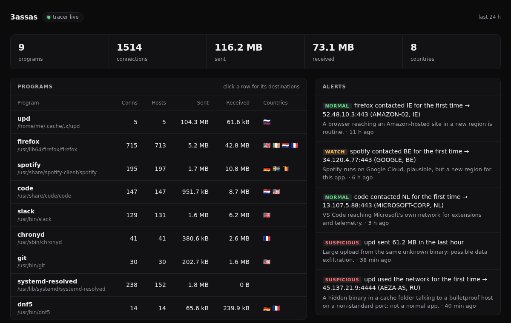

# 3assas

*"the guard" in Darija.* See which program on your Linux machine talks to whom, from inside the kernel.



<sub>Demo data (docs/demo/gen.py): a hidden binary in `~/.cache` uploading to a Russian host gets flagged, a browser
reaching a new CDN region does not.</sub>

```
13:41:09  → TCP  curl               140.82.121.3:443        api.github.com · GITHUB - GitHub, Inc. · GB
13:41:09  ✓ TCP  curl               140.82.121.3:443        0.2s  ↑1.9 kB  ↓548.2 kB
13:41:11  ✗ TCP  curl               192.0.2.1:81            no answer after 2.0s
13:41:11  ↗ UDP  brave              142.251.39.206:443      ↑1.2 kB  GOOGLE - Google LLC · US
```

DNS-level blockers only see names. 3assas sees every outbound TCP connection and UDP flow, attributed to the
executable that opened it: hardcoded IPs, DNS-over-HTTPS, QUIC, apps that never ask your resolver.

## How it works

| Hook | What it catches | Cost |
|---|---|---|
| `tp_btf/inet_sock_set_state` → `SYN_SENT` | outbound TCP connect, owner pid/uid/comm | once per connection |
| `tp_btf/inet_sock_set_state` → `CLOSE` | duration, payload bytes both ways, failed handshakes | once per connection |
| `fentry/udp_sendmsg`, `udpv6_sendmsg` | UDP flows (QUIC, DNS, games) | map lookup per send, event once per flow / 30 s |
| `cgroup_skb/ingress` on the root cgroup | DNS answers (UDP from port 53), copied raw to userspace | 2 header reads per received packet |

Design choices:
- **No per-packet path for TCP.** Byte counts are read from `tcp_sock` once at close (`bytes_sent - bytes_retrans`,
  `bytes_received` minus the FIN), not summed from `sendmsg` calls.
- **Owner captured at `SYN_SENT`.** The transition to `CLOSE` often runs in softirq context where `current` is an
  unrelated task, so the owner is stored per socket when `connect()` runs.
- **CO-RE.** Built against the running kernel's BTF (`vmlinux.h` is generated at build time), checked downcast with
  `bpf_skc_to_tcp_sock`.
- **Domains from the answers the machine already gets.** The kernel copies each DNS answer (up to 1232 bytes, the
  EDNS default) into the same ring buffer as connections, so an answer is always read before the connect it enables.
  Userspace parses it (compression pointers bounded, names limited to hostname characters: the packet comes off the
  network) and tags each address with the name that was *asked*, not the CDN alias at the end of the CNAME chain.
  Seen on loopback too, so it works behind systemd-resolved. Not seen: DNS-over-HTTPS/TLS and DNS over TCP; the
  connection then keeps its IP, owner and country.
- **The observer reports its blind spots.** A per-CPU counter tracks events lost to a full ring buffer or map, and the
  summary says so.

Userspace (Rust, libbpf-rs) resolves `/proc/<pid>/exe`, labels IPs with their network owner
([iptoasn](https://iptoasn.com), PDDL) and country ([DB-IP Lite](https://db-ip.com), CC BY 4.0) through binary search on
in-memory range tables, and prints a line per event or JSON lines (`--json`). Ctrl-C prints a per-program summary.

## Run

Linux ≥ 5.11 with BTF (`/sys/kernel/btf/vmlinux`), clang, bpftool, libelf.

```sh
mkdir -p data
curl -L -o data/ip2asn.tsv.gz https://iptoasn.com/data/ip2asn-combined.tsv.gz
curl -L -o data/dbip-country.csv.gz https://download.db-ip.com/free/dbip-country-lite-$(date +%Y-%m).csv.gz
cargo build --release
sudo ./target/release/3assas            # --json, --all (include loopback)
```

## Service mode, agent and web page

```sh
sudo ./install.sh     # builds, installs and starts both services at boot
```

- `3assas.service` (root, capabilities bounded to BPF/PERFMON/NET_ADMIN/PTRACE): `3assas --db /var/lib/3assas/3assas.db` writes
  every event to SQLite (WAL, one transaction per batch, 30-day retention).
- `3assas-agent.service` (your user, read-only on the tracer database): every 30 s it flags a program's first time on
  the network, its first contact with a country, or more than 50 MB sent in an hour. An AI (Gemini) judges each flag
  `normal` / `watch` / `suspicious` from the program's last 24 h; anything not normal goes to Telegram. Evening report
  at 21:00. The first 24 h only learn what is normal.
- Web page on `http://127.0.0.1:4545`: programs with their destinations, alerts with verdicts, the report, live feed.
  Bound to localhost and guarded against DNS rebinding (Host header check).

Optional agent config, in `~/.config/3assas/` (mode 600): `gemini` (API key, free tier is enough; or `GEMINI_API_KEY`),
`telegram` (bot token) and `telegram_chat` (chat id). Without them the agent still flags, and the page still shows
everything; there is just no AI verdict or Telegram message. `ASSAS_LANG` sets the language of verdicts and reports.

## Tests

```sh
cargo test                                          # event and DNS parsing, range lookups, database migration
sudo -E cargo test --release -- --include-ignored   # end to end: exact byte counts, a fake DNS answer names the connection
cd agent && python3 -m unittest test_agent         # alert rules, learning period, Telegram retry
```

## Demo

```sh
python3 docs/demo/gen.py    # the real page on http://127.0.0.1:8056 with a fake day and a moving live feed
```

`docs/demo/record.mjs` films it through a headless Chromium (DevTools protocol) and `docs/demo/gif.sh` makes the GIF.

## Limits

- Outbound only; sockets opened before 3assas started are not seen.
- UDP bytes are sent bytes, sampled every 30 s per flow; the tail of a flow after its last report is not counted.
- Country is a geolocation guess and the network owner is the ASN, not the service (a CDN hides the real site).

License: GPL-2.0 (the kernel program uses GPL-only helpers).
